<div align="center">

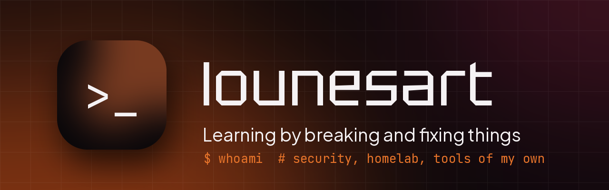

<br><br>

<a href="#about"></a>&nbsp;
<a href="#featured"></a>&nbsp;
<a href="#achievements"></a>&nbsp;
<a href="#stack"></a>&nbsp;
<a href="#projects"></a>

</div>


## About

Just a curious mind exploring cybersecurity, understanding how things work, and gaining control over technology. Little by little, I learn by breaking and fixing things, tinkering it all together. It's not always about the outcome, it's the motion itself that sets me free.

<p align="center">
  
  
  
  
  
</p>

<div align="right"><a href="#readme"><sub>Back to top</sub></a></div>


## Featured

<a href="https://github.com/lounesart/julz">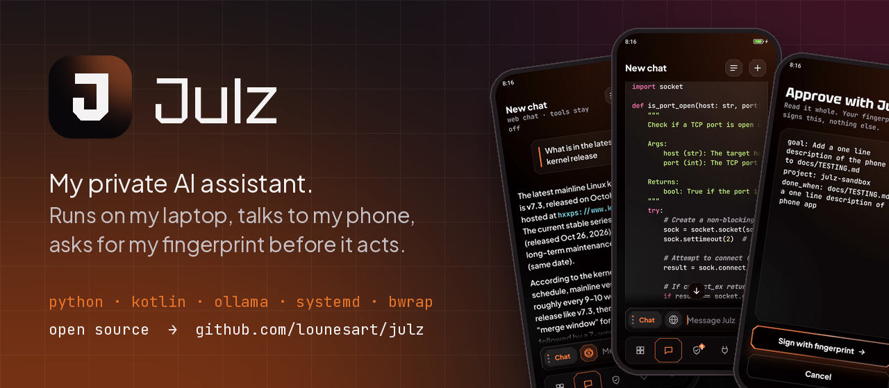</a>

A local AI that knows my notes, plans my study week and hands bigger coding jobs to Claude Code
inside a sandbox, only after I read the task on my phone and sign it with my fingerprint.

<p align="center">
  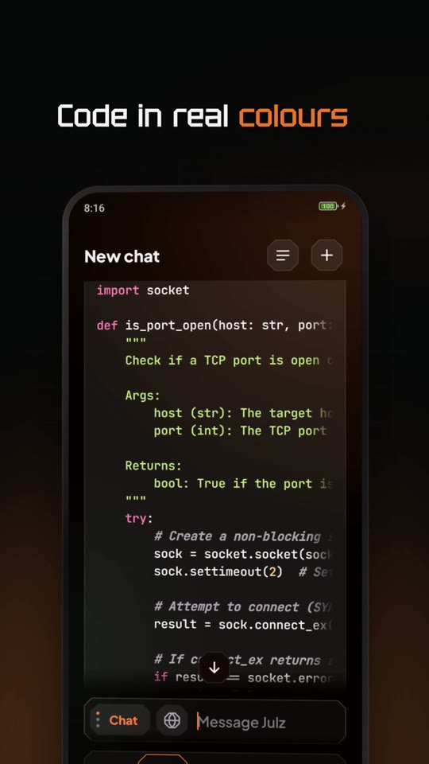
  <a href="https://github.com/lounesart/julz/blob/main/docs/media/julz-promo.mp4"></a>
  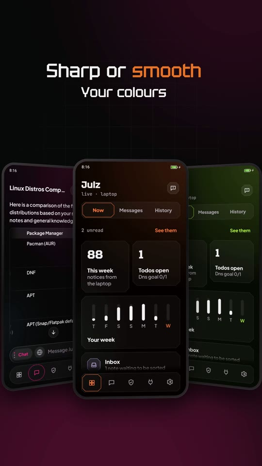
  <br><br>
  <a href="https://github.com/lounesart/julz"></a>
  <a href="https://github.com/lounesart/julz/blob/main/docs/media/julz-promo.mp4"></a>
</p>

<br>

<a href="https://github.com/lounesart/sysreport">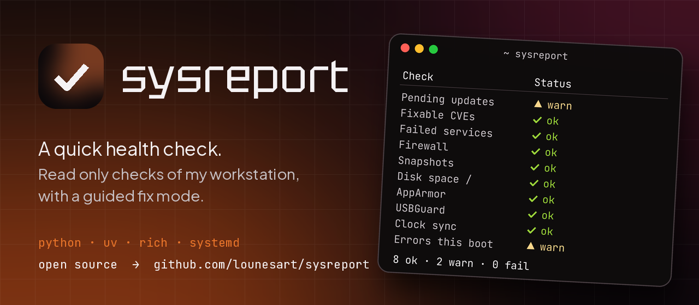</a>

One command shows updates, fixable CVEs, failed services, the firewall, snapshots, disk space,
AppArmor, USBGuard and clock sync as a table. If something is off, `sysreport --explain` says
what is wrong and how to fix it, without running anything.

<p align="center">
  <a href="https://github.com/lounesart/sysreport"></a>
  <a href="https://github.com/lounesart/sysreport#install"></a>
</p>

<div align="right"><a href="#readme"><sub>Back to top</sub></a></div>


## Achievements

<p align="center">
  <a href="https://academy.hackthebox.com/">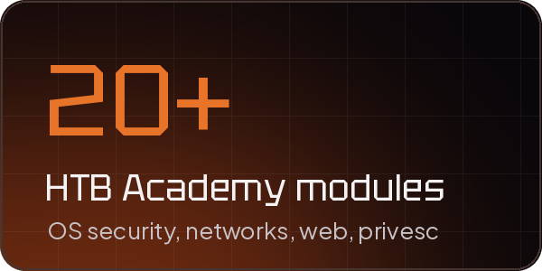</a>
  <a href="https://www.hackthebox.com/">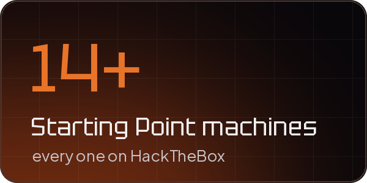</a>
  <a href="https://overthewire.org/wargames/bandit/">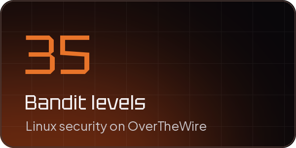</a>
  <a href="https://overthewire.org/wargames/natas/">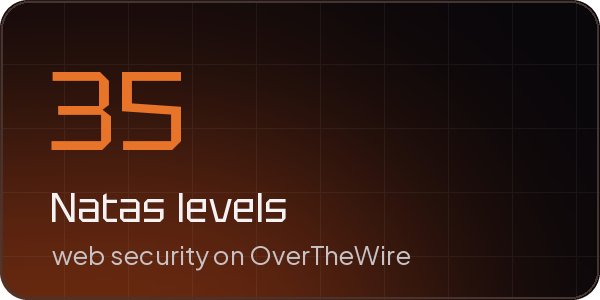</a>
</p>

- [x] **[HTB Academy](https://academy.hackthebox.com/)**
  Completed 20+ cybersecurity training modules covering
  `OS Security` | `Network Analysis` | `Web App Vulnerabilities` | `Privilege Escalation Techniques`

- [x] **[HackTheBox](https://www.hackthebox.com/)**
  Completed all **Starting Point** machines (14+ vulnerable systems), gaining hands on experience in
  `Network Scanning` | `Vulnerability Exploitation` | `Privilege Escalation`

- [x] **[OverTheWire Bandit](https://overthewire.org/wargames/bandit/)**
  Solved 35 progressively challenging Linux security assignments showing
  `Command Line Proficiency` | `System Vulnerability Identification` | `Security Bypass Techniques`

- [x] **[OverTheWire Natas](https://overthewire.org/wargames/natas/)**
  Solved 35 progressively challenging web security levels showing
  `Source Analysis` | `Injection` | `Session and Cookie Tampering`

- [x] **Security tools development**
  Built [bshred.py](https://github.com/lounesart/Scripts/blob/main/Python/bshred.py), a precision alternative to GNU [shred](https://www.gnu.org/software/coreutils/manual/html_node/shred-invocation.html) that
  - performs surgical overwrites of sensitive strings, like passwords in logs
  - forces a disk sync with `os.fsync()` so they can't be recovered
  - keeps the original file structure, unlike full file wiping

### Student transcript

<details>
<summary><b>HTB Academy student transcript</b>&nbsp; <sub>tap to open</sub></summary>
<br>

<a href="https://raw.githubusercontent.com/lounesart/Images/main/fragment-1.png">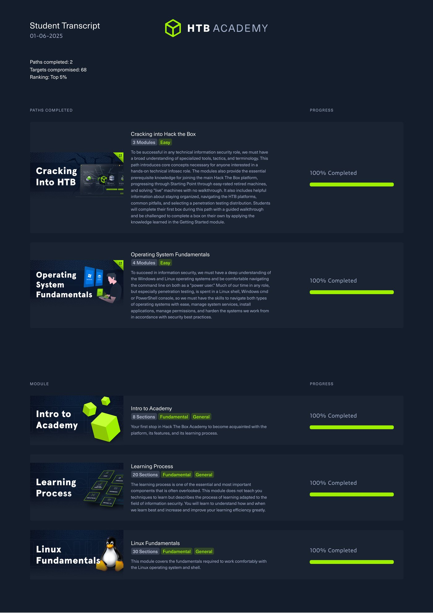</a>
<a href="https://raw.githubusercontent.com/lounesart/Images/main/fragment-2.png">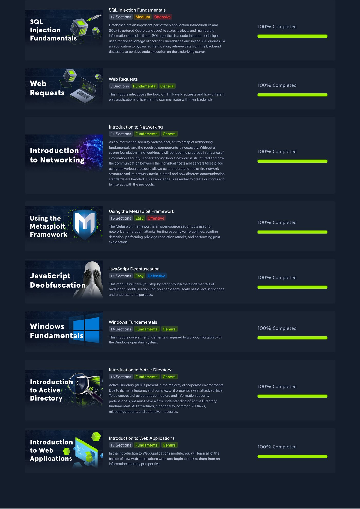</a>
<a href="https://raw.githubusercontent.com/lounesart/Images/main/fragment-3.png">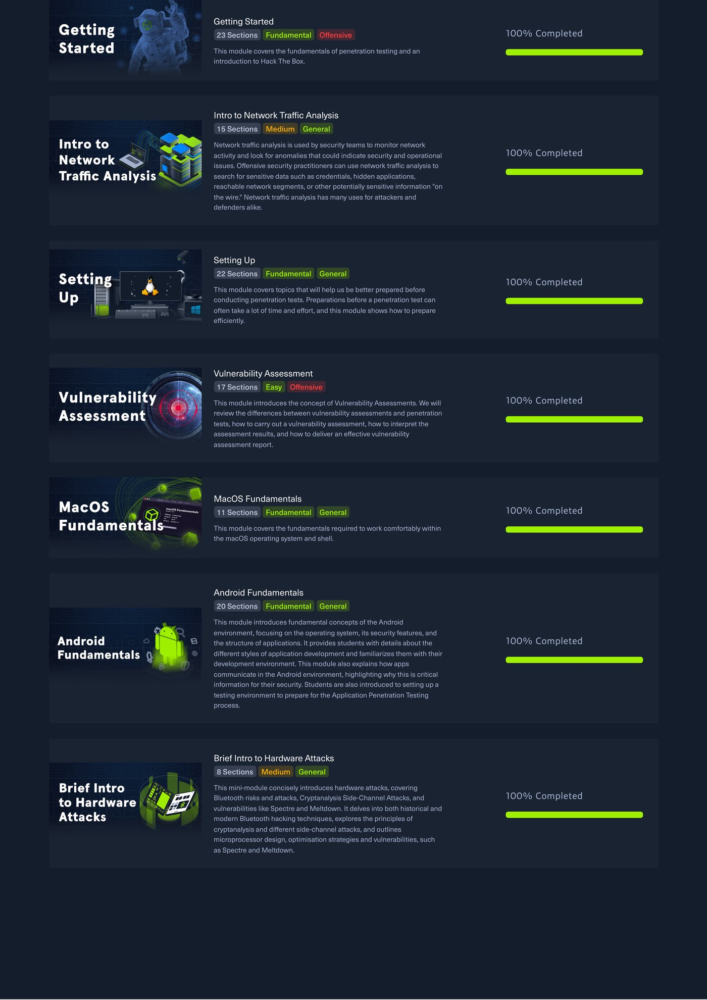</a>
<a href="https://raw.githubusercontent.com/lounesart/Images/main/fragment-4.png">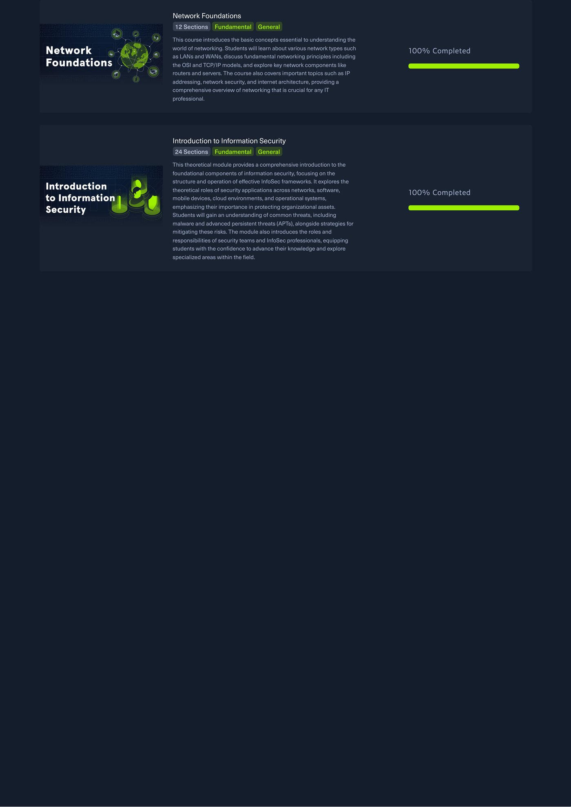</a>

<sub>HTB Academy, June 2025. Tap a page for the full scan.</sub>

</details>

<div align="right"><a href="#readme"><sub>Back to top</sub></a></div>


## Stack

<p align="center"><sub><b>DAILY</b></sub><br>
  
  
  
  
  
</p>

<p align="center"><sub><b>LEARNING</b></sub><br>
  
  
</p>

<p align="center"><sub><b>NEXT</b></sub><br>
  
  
  
</p>

<div align="right"><a href="#readme"><sub>Back to top</sub></a></div>


## Projects

```diff
+ Julz, my local AI assistant with a phone app
+ sysreport, a health check for my workstation
+ Homelab built, a hardened Linux host with nftables, AppArmor and USBGuard
+ KVM labs for my cybersecurity shenanigans, including an Active Directory domain
+ Self hosted Ollama, SearXNG and ntfy, reachable over Tailscale only
! Studying for CompTIA A+, Network+ and Security+, then HTB CPTS
# Developing a personal toolbelt in Bash/Python
```

<sub>Updated October 2026</sub>

<div align="right"><a href="#readme"><sub>Back to top</sub></a></div>
